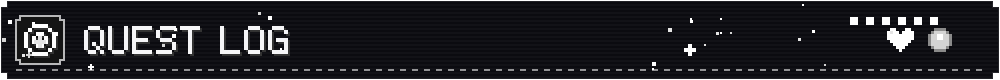
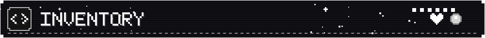
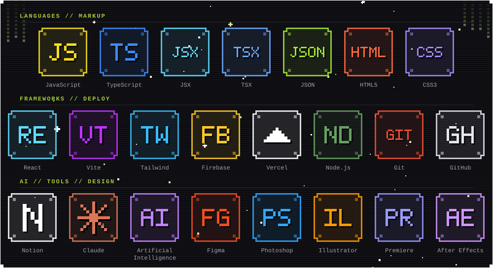
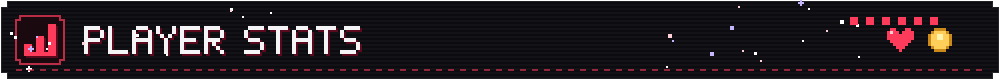

 

 

> There's a huge difference between a regular AI user and a software engineer using AI.
> One copy-pastes prompts and prays it runs. The other knows how to fix the broken code it spits out.

 

 

  

 

  

 

  

