 

 

 

> There's a huge difference between a regular AI user and a software engineer using AI.
> One copy-pastes prompts and prays it runs. The other knows how to fix the broken code it spits out.

 

 

<b>FRONTEND</b> 

  

<b>BACKEND & TOOLING</b> 

  

<b>DESIGN & MOTION</b> 

  

 

 

  

 
<picture>
  <source media="(prefers-color-scheme: dark)" srcset="https://raw.githubusercontent.com/theSideQuestNPC/theSideQuestNPC/output/github-snake-dark.svg" />
  <source media="(prefers-color-scheme: light)" srcset="https://raw.githubusercontent.com/theSideQuestNPC/theSideQuestNPC/output/github-snake.svg" />
  
</picture>
  

  

 

  

